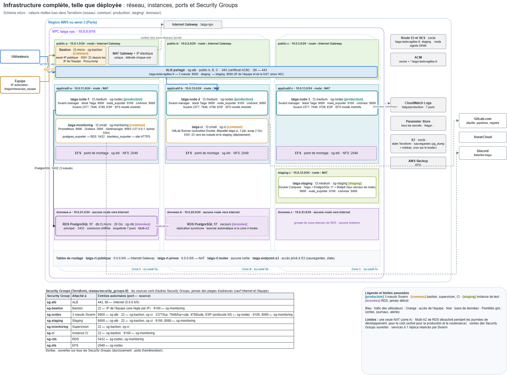

# Taiga sur AWS

> **In English.** End-of-training project (DevOps system administrator, La Capsule, 2026), built by a team of three. We deployed Taiga, an open-source project management tool, on AWS with a staging and a production environment, using Terraform, Ansible, Docker Swarm and GitLab CI. The documentation is in French.

## Le projet

Pour notre projet de fin de formation d'administrateur système DevOps à La Capsule, nous avons déployé Taiga, un outil open source de gestion de projet, pour Le Dev à Gilles, l'entreprise cliente imaginée par le sujet. Il y a deux environnements. Le staging sert à tester chaque mise à jour, et la production doit rester disponible même si un serveur tombe. Nous l'avons fait à trois en deux semaines, du 22 octobre au 6 novembre 2026, sur mon compte AWS.

## Les outils

L'infrastructure est décrite avec Terraform sur AWS (VPC sur trois zones, ALB, EC2, RDS PostgreSQL Multi-AZ, EFS, S3, Route 53, SES, Parameter Store). Ansible configure les machines et déploie Taiga sur trois nœuds Docker Swarm. GitLab CI contrôle le code avec tflint, Trivy et Gitleaks, construit les images du back et du front, déploie le staging puis la production sur un bouton, et lance les tests E2E avec Playwright et les tests de charge avec Locust. Prometheus, Grafana et Alertmanager surveillent l'ensemble et envoient les alertes sur Discord.



## Les résultats

Taiga tourne en HTTPS sur le staging et sur la production. Le site tient la perte d'un serveur avec environ 16 secondes de perturbation, et une nouvelle version arrive en production sans coupure. À 50 utilisateurs, le staging répond en moins de 40 ms pour la moitié des requêtes. Une sauvegarde de la production a été restaurée, et nous avons détruit puis reconstruit les machines et les services communs en 1 h 15 environ.

## Les limites et la suite

Terraform se lance encore depuis nos postes et non depuis la CI, et une seule NAT sert les trois zones pour limiter le coût. Les prochaines étapes sont un `terraform plan` dans chaque merge request avec un accès AWS par OIDC, une NAT par zone, un test chronométré de la bascule de la base Multi-AZ et le passage de Taiga sur Kubernetes avec K3s.

## L'équipe

Fatima Achour, Samuel Johansen et moi, Guillaume Porte. Chacun de nous a touché à toutes les briques du projet. Ce dépôt réunit le travail de nos trois dépôts GitLab, dans l'état du 21 novembre 2026, sans leur historique.

Le dossier [`applications/`](applications/) contient ce que nous avons ajouté au back et au front de Taiga, c'est-à-dire leurs pipelines, l'analyse SonarCloud et le Dockerfile du front. Le code de Taiga lui-même reste dans ses dépôts d'origine, [taigaio/taiga-back](https://github.com/taigaio/taiga-back) sous licence MPL 2.0 et [taigaio/taiga-front](https://github.com/taigaio/taiga-front) sous licence AGPL v3. Les pipelines tournaient sur GitLab.com et ne se lancent pas sur GitHub.

Les premières décisions d'architecture sont dans [`docs/adr/`](docs/adr/).

---

## Exploiter l'infrastructure

Infrastructure AWS (région Paris, `eu-west-3`) de Taiga pour le client « Le Dev à Gilles » : Terraform et Ansible. Deux environnements, `staging` et `production`, dans un seul VPC.

## Organisation du dépôt

Un dossier par outil. Dans `terraform/`, un dossier = un projet Terraform = un state, rangé dans le bucket du socle.

| Dossier | Contenu | Détruit ? |
|---|---|---|
| `terraform/socle/` | bucket du state, bucket des sauvegardes, zone DNS, secrets (Parameter Store), domaine SES et son utilisateur d'envoi | jamais |
| `terraform/reseau/` | VPC, sous-réseaux, routes, NAT, security groups | rarement (la NAT : chaque soir) |
| `terraform/donnees/` | la base RDS de la production | jamais (arrêtée le soir) |
| `terraform/commun/` | ce qui sert aux deux environnements : bastion, supervision, runner CI, ALB, certificat, DNS du site, rôles IAM | oui, à la demande (l'ALB : chaque soir) |
| `terraform/staging/` | l'instance du staging | oui, à la demande |
| `terraform/production/` | les 3 nœuds Swarm de production, l'EFS | oui, à la demande |
| `cles_ssh/` | les clés SSH **publiques** de l'équipe, posées sur toutes les instances | |
| `ansible/` | configuration des machines | |
| `docs/` | procédures (runbooks rangés par thème) et références : index dans `docs/README.md` | |
| `applications/` | ce que nous avons ajouté au back et au front de Taiga (pipelines, SonarCloud, Dockerfile du front) | |

Chaque dossier a son propre `README.md` : ce qui est en place, comment l'utiliser, les pièges.

## Ordre

- **Création** : `socle` (une seule fois) → `reseau` → `donnees` → `commun` → `staging` et/ou `production`.
- **Destruction** : l'ordre inverse. Détruire `staging/` ne touche pas à la production, et inversement. `reseau/` ne peut pas être détruit tant que la base (`donnees/`) existe.
- `staging/` et `production/` lisent `reseau/` (sorties du state) et `commun/` (profils IAM et target groups, cherchés par leur nom) : leur `plan` échoue tant que `commun/` n'est pas appliqué.
- **Le matin** : `reseau/` (NAT) → `commun/` (ALB, DNS) → **ensuite** les machines (`docs/runbooks/2-chaque-jour/arreter_demarrer.md`).
- **Compte AWS neuf** (rien n'existe, pas même le bucket du state) : `docs/runbooks/7-urgence/changer_de_compte_aws.md`.

## Démarrer

Prérequis : Terraform 1.16.6, AWS CLI avec ses clés personnelles (`aws configure`), région `eu-west-3`, heure de la VM à jour (sinon `AuthFailure`).

```bash
cd terraform/reseau
terraform init
terraform plan
```

- La NAT est **détruite chaque soir** (coût) et recréée par tout `apply` complet de `terraform/reseau/` : voir `docs/runbooks/2-chaque-jour/eteindre_rallumer_nat.md`. Elle doit être allumée pour que les machines privées sortent sur Internet (paquets, images Docker, Parameter Store), y compris le runner CI.
- Les secrets ne sont jamais dans Git : ils vivent dans Parameter Store, sous `/taiga/<env>/…`.
- Le soir : arrêter ou détruire ce qui se paie à l'heure (instances, NAT, ALB) : `docs/runbooks/2-chaque-jour/arreter_demarrer.md`.
- Configurer les machines après Terraform : `ansible/README.md` (ordre des playbooks). Tout reconstruire : `docs/runbooks/7-urgence/reconstruire_tout.md`.

## Accès SSH

- Chacun a sa propre paire de clés ; seule la clé publique est dans `cles_ssh/` (voir son README). Pas de clé partagée.
- Au premier démarrage, chaque instance reçoit toutes les clés de `cles_ssh/` pour l'utilisateur `ubuntu` (cloud-init).
- Seul le bastion est joignable depuis Internet, et seulement depuis les IP de l'équipe (`docs/runbooks/1-equipe/changer_son_ip.md`). Les machines privées se joignent en rebondissant par le bastion (`ProxyJump`) ; la clé privée ne quitte jamais son poste.

## Travailler à plusieurs

- Une branche par sujet, depuis `staging` à jour, puis une merge request vers `staging`.
- Fusion **sans squash**. `staging` est protégée : aucun push direct.
- L'`apply` se fait depuis `staging` à jour, après la fusion, jamais depuis une branche incomplète.
- Un seul `apply` à la fois : le verrou du state (`.tflock` dans le bucket) bloque le deuxième. S'il reste coincé, `terraform force-unlock <ID>` seulement après avoir vérifié avec l'équipe.
- Deux personnes ne travaillent pas en même temps sur les mêmes fichiers.

## CI (contrôle qualité)

Le pipeline (`.gitlab-ci.yml`) tourne sur chaque push. Les jobs de contrôle ci-dessous tournent en parallèle, sans accès AWS. S'il est rouge, la merge request vers `staging` ne peut pas être fusionnée.

Il y a aussi les jobs de **déploiement et de test** (`deployer-staging`, tests E2E et de charge, bouton `deployer-production`), sur notre runner privé et protégé `taiga-ci`, avec le rôle IAM de l'instance CI : `docs/runbooks/3-deployer/comprendre_le_pipeline.md`.

| Job | Vérifie |
|---|---|
| `terraform-fmt` | le format de tous les `.tf` |
| `terraform-validate` | la cohérence de chaque dossier de `terraform/` (boucle : un nouveau dossier est validé tout seul) |
| `tflint` | les mauvaises pratiques (variables inutilisées, versions non fixées) |
| `trivy` | les failles de configuration graves (`HIGH`, `CRITICAL`) |
| `gitleaks` | les secrets dans tout l'historique Git |
| `ansible-lint` | les bonnes pratiques Ansible (en pause, à réactiver avec les rôles) |

Avant de pousser : `terraform fmt -recursive terraform/` (corrige le format).

### Pièges
- **Dossier dans `terraform/`** : seulement des projets Terraform (la boucle de validation les parcourt tous).
- **Alerte trivy acceptée** : l'ajouter dans `.trivyignore` avec une ligne de justification. AWS-0104 (sorties ouvertes) est temporaire : la retirer quand les sorties des security groups seront durcies.
- **Versions** : les images sont épinglées. Pour en changer, vérifier le tag dans le registre (avec ou sans `v` selon l'outil).
- **yamllint** est en pause (job `.yamllint`, caché par le point) : à réactiver avec Ansible.

### Pistes d'amélioration
- `terraform plan` dans la CI, avec un accès AWS par OIDC (sans clé stockée dans GitLab).
- Plugin AWS de tflint.
- pre-commit pour lancer les mêmes contrôles avant chaque commit.

## Décisions

Les décisions d'architecture (ADR) étaient tenues dans Confluence, un espace privé. Mes copies des premières sont dans [`docs/adr/`](docs/adr/).
